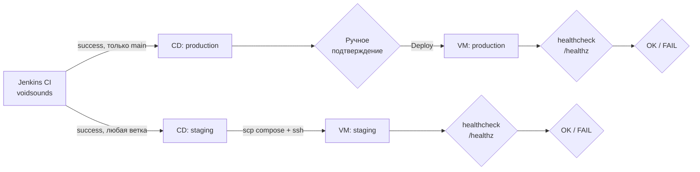

# -jenkins-pipelines

CD-джобы для приложения [VoidSounds](https://github.com/Clementineqq/VoidSounds).
CI только собирает и публикует образ в GHCR, деплой живёт здесь — так проще
разделять права: сборку запускает любой коммит, а раскатка в продакшен идёт
только через ручное подтверждение.

## Схема доставки



Оба стенда пока разворачиваются на одной VM, в одном каталоге и на одном порту,
поэтому одновременно работать не могут.

## Файлы

| Файл | Назначение |
|---|---|
| `cd/staging.groovy` | деплой на staging |
| `cd/production.groovy` | деплой в продакшен с подтверждением |
| `docker-compose.staging.yml` | описание staging-стенда |
| `docker-compose.production.yml` | описание production-стенда |

Compose-файлы лежат здесь, а не в репозитории приложения: приложение собирает
образ и ничего не знает про конкретные стенды. Оба файла копируются на VM в
каталог `~/voidsounds`.

## Как устроен деплой

1. `sshagent` поднимает ключ `debian-vm-ssh`; отпечаток VM заранее добавлен в
   `known_hosts` .
2. `scp` копирует нужный compose-файл на VM в `~/voidsounds`.
3. `ssh`: `docker pull ghcr.io/clementineqq/voidsounds:<IMAGE_TAG>` и
   `docker compose -f <файл> up -d`.
4. Healthcheck: до 30 попыток с паузой 2 секунды на
   `http://localhost:8080/healthz`. Если приложение не ответило — джоба падает,
   деплой считается неуспешным.
5. Результат уходит в Slack через `notify` из общей библиотеки (если креденшен
   Slack не настроен, шаг просто пишет в лог и не валит сборку).

Образ всегда тянется по тегу-SHA коммита, а не по `latest`, поэтому на стенде
всегда видно, какой коммит запущен, и откат сводится к деплою предыдущего тега.

### Переменные окружения

| Стенд | Источник значений |
|---|---|
| production | `prod-db-password` и `prod-session-secret` из Jenkins Credentials, передаются в `docker compose` через окружение ssh-команды |
| staging | дефолты из `docker-compose.staging.yml` (`stagingpass`, `staging-secret`)  |

Дополнительно на VM в `~/voidsounds/.env` лежат значения для ручных
перезапусков (`DB_PASSWORD`, `SESSION_SECRET`, `IMAGE_TAG`). Значения из
пайплайна имеют приоритет над файлом `.env`.

## Настройка джоб

Обе джобы — *Pipeline script from SCM*, репозиторий `-jenkins-pipelines`,
ветка `main`.

| Джоба | Script Path | Агент | Параметры |
|---|---|---|---|
| `voidsounds-cd-staging` | `cd/staging.groovy` | `any` (контроллер) | `IMAGE_TAG` (string) |
| `voidsounds-cd-production` | `cd/production.groovy` | `docker-build` | `IMAGE_TAG` (string) |

Джобы вызываются из CI шагом `build job: ...`, параметр `IMAGE_TAG` — первые
7 символов SHA коммита. Ожидание отключено (`wait: false`): CI не висит, пока
идёт деплой.

Production-джоба дополнительно требует подтверждения: шаг `input` с кнопкой
`Deploy`, доступен только пользователю `admin`.

## Credentials

| ID | Тип | Где используется |
|---|---|---|
| `debian-vm-ssh` | SSH username with private key | обе джобы, подключение к VM |
| `prod-db-password` | Secret text | production, пароль PostgreSQL |
| `prod-session-secret` | Secret text | production, ключ подписи сессий |
| `github-registry` | Username + password | CI в репозитории приложения, логин в GHCR |


## known_hosts

`ssh` и `scp` в неинтерактивной сессии падают на проверке host key, поэтому
отпечаток VM добавляется заранее — на той машине, которая подключается.

Агент `docker-build` (production):

```bash
ssh-keyscan -H 192.168.56.101 >> /home/vboxuser/.ssh/known_hosts
chmod 600 /home/vboxuser/.ssh/known_hosts
```

## Проверка деплоя

```bash
cd ~/voidsounds
docker compose -f docker-compose.production.yml ps
curl -i -s localhost:8080/healthz
docker images ghcr.io/clementineqq/voidsounds --format 'table {{.Tag}}\t{{.CreatedSince}}'
```

Ожидаемо: контейнеры в статусе `Up` (у PostgreSQL — `healthy`), ответ
`HTTP/1.1 200 OK`, среди образов — тег последнего задеплоенного коммита.

## Ограничения

- [ ] staging и production используют один каталог (`~/voidsounds`), одно имя
      compose-проекта (`voidsounds`) и оба маппят порт `8080`. Деплой staging
      пересоздаёт прод-контейнеры, одновременно два стенда не поднимаются.
- [ ] staging не получает секреты из Credentials — работает на дефолтах compose
- [ ] нет отдельной джобы отката: откат = запуск деплоя с предыдущим тегом
- [ ] healthcheck проверяет только, что порт отвечает, а не конкретную версию
      приложения
- [ ] деплой императивный (`ssh` + `compose`); план — Ansible playbook
- [ ] у production-compose нет сервиса миграций: при изменении схемы БД
      миграции нужно применять отдельно