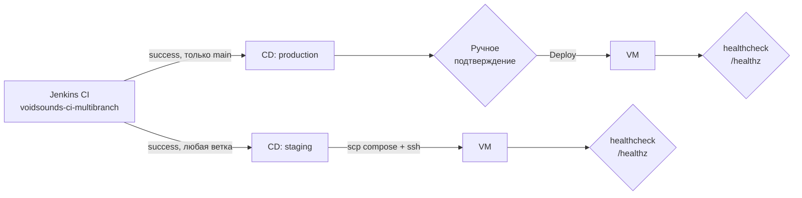

# -jenkins-pipelines

CD-джобы для приложения [VoidSounds](https://github.com/Clementineqq/VoidSounds).
CI только собирает и публикует образ в GHCR, деплой живёт здесь — так проще
разделять права: сборку запускает любой коммит, а раскатка в продакшен идёт
только через ручное подтверждение.

## Схема доставки



Оба стенда разворачиваются на одной VM, в одном каталоге `~/voidsounds`,
в одном compose-проекте `voidsounds`. Разнести стенды — в планах.

## Файлы

| Файл | Назначение |
|---|---|
| `cd/staging.groovy` | деплой на staging |
| `cd/production.groovy` | деплой в продакшен с подтверждением |
| `docker-compose.staging.yml` | описание staging-стенда |
| `docker-compose.production.yml` | описание production-стенда |

Compose-файлы лежат здесь, а не в репозитории приложения: приложение собирает
образ и ничего не знает про конкретные стенды. Оба файла копируются на VM в
каталог `~/voidsounds`.

## Как устроен деплой

1. `sshagent` поднимает ключ `debian-vm-ssh`; отпечаток VM заранее добавлен
   в `known_hosts` на агенте.
2. `scp` копирует нужный compose-файл на VM в `~/voidsounds`.
3. `ssh`: `docker pull ghcr.io/clementineqq/voidsounds:<IMAGE_TAG>` и
   `docker compose -f <файл> up -d`.
4. Healthcheck: до 30 попыток с паузой 2 секунды на
   `http://localhost:8080/healthz`. Если приложение не ответило — джоба падает,
   деплой считается неуспешным.
5. Результат уходит в Slack через `notify` из общей библиотеки. Если
   креденшел Slack не настроен, шаг пишет в лог и не валит сборку.

Обе джобы выполняются на агенте `docker-build`: ему нужны Docker и SSH-ключ
до стендов. Контроллер в деплое не участвует.

Образ всегда тянется по тегу-SHA коммита, а не по `latest`, поэтому на стенде
всегда видно, какой коммит запущен, и откат сводится к деплою предыдущего тега.

### Переменные окружения

| Стенд | Источник значений |
|---|---|
| production | `DB_PASSWORD` из `prod-db-password`, `SESSION_SECRET` из `prod-session-secret`. Передаются в окружении ssh-команды и перекрывают `.env` |
| staging | своих секретов нет: compose читает общий `~/voidsounds/.env`, где лежат **прод**-значения. Дефолты `stagingpass` / `staging-secret` из `docker-compose.staging.yml` — заглушки, применяются только если `.env` отсутствует |

В `~/voidsounds/.env` лежат `DB_PASSWORD`, `SESSION_SECRET` и `IMAGE_TAG` для
ручных перезапусков. Файл общий для обоих стендов — следствие того, что они
живут в одном каталоге.

## Настройка джоб

Обе джобы — *Pipeline script from SCM*, репозиторий `-jenkins-pipelines`,
ветка `main`, агент `docker-build`.

| Джоба | Script Path | Параметры |
|---|---|---|
| `voidsounds-cd-staging` | `cd/staging.groovy` | `IMAGE_TAG` (string) |
| `voidsounds-cd-production` | `cd/production.groovy` | `IMAGE_TAG` (string) |

Ветка задаётся в **Configure → Pipeline → SCM → Branch Specifier** и должна
быть `*/main`. Если там другая ветка, джоба возьмёт старые скрипты (`Checking out Revision ... (refs/remotes/origin/<ветка>)`).

Джобы вызываются из CI шагом `build job: ...`, параметр `IMAGE_TAG` — первые
7 символов SHA коммита. Ожидание отключено (`wait: false`): CI не висит, пока
идёт деплой.

Production-джоба дополнительно требует подтверждения: шаг `input` с кнопкой
`Deploy`, доступен только пользователю `admin`.

## Credentials

| ID | Тип | Где используется |
|---|---|---|
| `debian-vm-ssh` | SSH username with private key | обе джобы, подключение к VM |
| `prod-db-password` | Secret text | production, пароль PostgreSQL |
| `prod-session-secret` | Secret text | production, ключ подписи сессий |
| `github-registry` | Username + password | CI в репозитории приложения, логин в GHCR |

## known_hosts

`ssh` и `scp` в неинтерактивной сессии падают на проверке host key, поэтому
отпечаток VM добавляется заранее — на той машине, которая подключается.
Обе джобы запускаются на агенте `docker-build`:

```bash
ssh-keyscan -H 192.168.56.101 >> /home/vboxuser/.ssh/known_hosts
chmod 600 /home/vboxuser/.ssh/known_hosts
```

## Проверка деплоя

```bash
cd ~/voidsounds
docker compose -f docker-compose.production.yml ps
docker ps --format 'table {{.Names}}\t{{.Image}}\t{{.Status}}'
curl -i -s localhost:8080/healthz
```

Ожидаемо: контейнеры в статусе `Up` (у PostgreSQL — `healthy`), ответ
`HTTP/1.1 200 OK`, среди образов — тег последнего задеплоенного коммита.

Какой стенд сейчас поднят, видно по именам контейнеров:

- `voidsounds_postgres_prod`, `voidsounds_app_prod` — production;
- `voidsounds-postgres-1`, `voidsounds-app-1` — staging.

## Ограничения

- [ ] staging и production используют один каталог (`~/voidsounds`), одно имя
      compose-проекта (`voidsounds`) и оба маппят порт `8080`. Деплой staging
      пересоздаёт прод-контейнеры, и наоборот — это видно в логах:
      `Container voidsounds_postgres_prod Recreated` при деплое staging и
      `Container voidsounds-postgres-1 Recreated` при деплое production.
      Одновременно два стенда не поднимаются.
- [ ] у стендов общий volume `voidsounds_postgres_data`, то есть одна база:
      данные и миграции staging попадают в production
- [ ] у staging нет собственных секретов: он читает прод-значения из общего
      `~/voidsounds/.env`
- [ ] healthcheck проверяет только `localhost:8080` на VM, а не конкретный
      контейнер и не версию приложения: при коллизии стендов он может
      подтвердить «здоровье» соседа
- [ ] нет отдельной джобы отката: откат = запуск деплоя с предыдущим тегом
- [ ] деплой императивный (`ssh` + `compose`); план — Ansible playbook
- [ ] у production-compose нет сервиса миграций: при изменении схемы БД
      миграции нужно применять отдельно
- [ ] IP VM и пользователь `vboxuser` захардкожены в `cd/*.groovy` — при
      переносе стендов правится код, а не параметры на данный момент